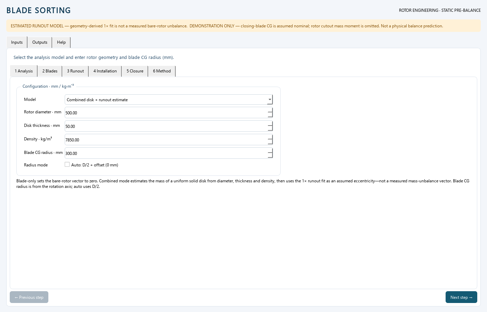
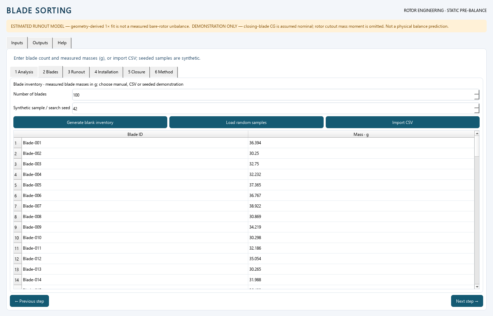
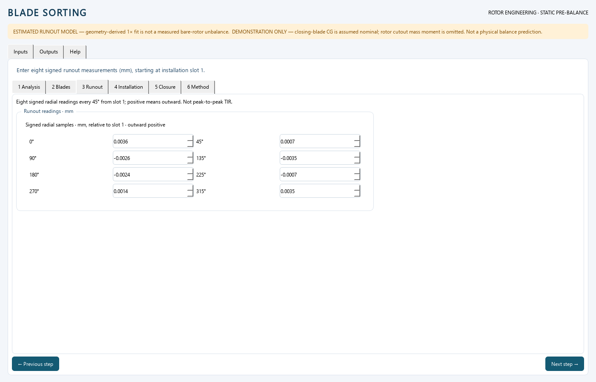
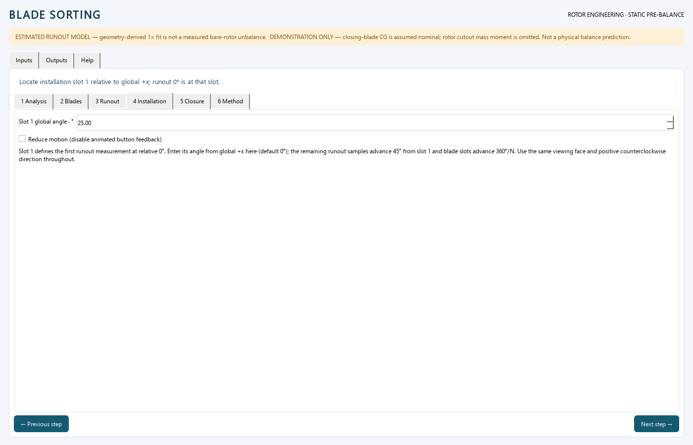
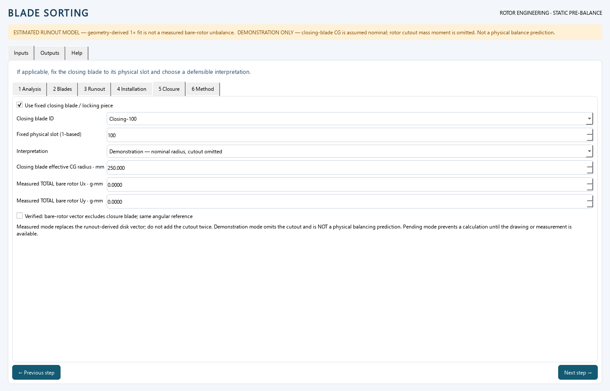
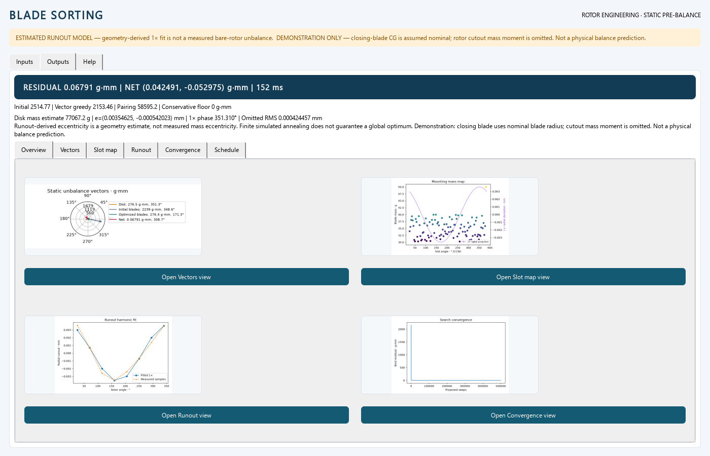
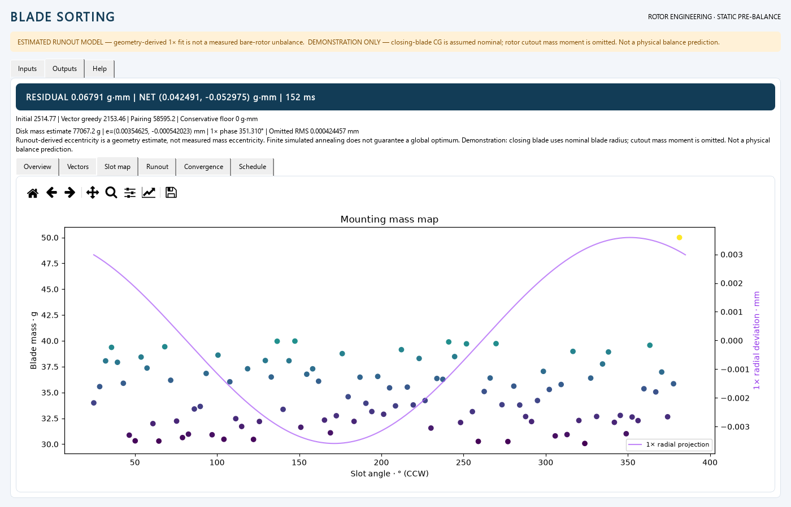

# Blade sorting

Personal desktop project for single-plane static blade-arrangement planning.

> **Engineering boundary:** blade-only sorting assumes an ideal concentric rotor. Rotor + blade sorting uses an estimated uniform-solid-disk mass eccentricity from an eight-point 1x runout fit and the specifically requested radial-projection slot model. Runout alone does not establish mass eccentricity. This is not dynamic balancing or release-to-service certification.

## Status and provenance

Developed from the owner’s existing `vijaikrish/blade_sorting` repository at baseline commit `7d01cdf9d3256a7b7a21a59a48420b46e516538a`. Original experiments are preserved under `legacy/` but are not imported by the desktop application.

The owner approved publishing this personal project after review. The application is **not** a production balancing-machine result or an acceptance authority.

[RESEARCH_NOTES.md](RESEARCH_NOTES.md) was written before application code. It compares inspected repositories, cites the reviewed literature, derives the quadratic objective and records modeling limits. Third-party repositories were inspected as references only; their unlicensed source is not incorporated into the application. Code is licensed under [MIT](LICENSE), as selected by the owner. The bundled contextual photographs retain separate CC BY-SA terms; see [image credits](ASSET_LICENSES.md).

## Run on this machine

Double-click **`Start_Blade_Sorting.bat`** in this directory. The launcher uses this project's isolated `.venv`, not global Python.

```bat
.venv\Scripts\python.exe main.py
```

For a synthetic demonstration, use `main.py --demo`. Sample values are generated for testing; they are not measured rotor data. The first compiled solver run can take longer than subsequent runs. Warm-up/JIT time and solve time are different quantities.

## Fresh setup

Use 64-bit CPython **3.14** (the verified environment). Create an isolated environment; do not use an unqualified `pip` pointing at another Python installation.

```bat
python -m venv .venv
.venv\Scripts\python.exe -m pip install -r requirements.txt
.venv\Scripts\python.exe main.py
```

For development:

```bat
.venv\Scripts\python.exe -m pip install -r requirements-dev.txt
.venv\Scripts\python.exe -m pytest -q
.venv\Scripts\python.exe -m ruff check .
```

For automated GUI checks without showing a desktop window, set `QT_QPA_PLATFORM=offscreen` before running pytest. Required packages are pinned to the locally verified versions. Numba is used to compile the O(1) swap loop; a compiler toolchain is not required when installing supported binary wheels. Python 3.15 and other platforms are not claimed as verified.

## Working procedure

The **Inputs** section follows the numbered steps; **Outputs** contains an overview, four individually navigable/zoomable graphs, and the mounting schedule. **Help** carries the illustrated operator guide.

1. **Analysis:** Select Blade-only or Rotor + blade. Set rotor diameter, disk thickness, density and nominal blade CG radius (mm). In blade-only mode the disk vector is zero; in combined mode the solid-disk/runout unbalance is an estimate, not a measurement.
2. **Blades:** Set N=2…120 and enter unique blade IDs/masses (g) manually in blank inventory, import CSV, or generate seeded synthetic samples. The seed also reproduces the solver search. No sample is a real measurement.
3. **Runout:** In combined mode, enter eight signed radial readings (mm) at 0°, 45°, …, 315° relative to slot 1, outward positive. Do not enter peak-to-peak TIR into these cells.
4. **Installation:** Set slot 1's global angle relative to +x (default 0°); runout starts at slot 1, while blade slots advance by 360°/N. Use one consistently declared observation face and verify instrument polarity and rotor-fixed phase.
5. **Closure:** If the row has a locking/closing blade, select its inventory ID and fixed physical slot. Choose Pending (blocks), Demonstration (nominal CG; cutout omitted), or Measured (effective closure CG radius and total bare-rotor vector **excluding** the closure blade). The 50 g example is gross blade mass, not a cutout correction. See [closure research](docs/CLOSURE_RESEARCH.md).
6. **Method:** Choose Hybrid SA or the Opposite pairing baseline and run optimization. The worker keeps the UI responsive; cancellation discards an unfinished result.
7. **Outputs:** Compare the residual and four thumbnail graphs on Overview; open each Vectors, Slot map, Runout or Convergence plot separately for toolbar zoom/pan. Inspect Schedule and export CSV. Any input edit invalidates the previous result and disables export.
8. Verify the assembled rotor using approved balancing equipment, procedures and limits before service. The [illustrated guide](docs/USER_GUIDE.html) explains each step and model boundary.

## Tutorial

The screenshots below use **synthetic** blade/runout data. They explain the controls, not a qualified balancing result. Use the [offline illustrated Help guide](docs/USER_GUIDE.html) for equations, phase conventions, engineering assumptions and cited closure examples; that same guide opens inside the app.

### 1 · Choose analysis model and rotor inputs

Open **Inputs → 1 Analysis**. Choose **Blade-only** if the rotor is treated as concentric, or **Combined** to include the uniform-solid-disk estimate. Set rotor diameter, disk thickness and density (default steel 7,850 kg/m³). Set the nominal blade CG radius in mm, or leave **Auto** checked for D/2. The combined estimate treats geometric 1× runout as if it were mass eccentricity—an explicit approximation, not a measurement.



### 2 · Enter blade inventory

In **2 Blades**, set N (2–120). **Generate blank inventory** leaves weight cells empty for manual measurements; **Import CSV** loads `blade_name,weight` data; **Load random samples** uses the displayed seed for a repeatable demonstration. For an example, import [`examples/100_blades_with_closure.csv`](examples/100_blades_with_closure.csv) (99 seeded 30–40 g blades plus `Closing-100` at 50 g). These are **not** measured blade masses.



### 3 · Record runout and position slot 1

In **3 Runout**, enter eight *signed* radial readings in mm at 45° intervals starting at slot 1. Outward is positive in this model; do not repeat a peak-to-peak TIR value. The inputs are inactive in Blade-only mode. In **4 Installation**, set slot 1's global angle from +x (default 0°), viewed consistently from the declared rotor face. The 0° runout reading is at slot 1; the remaining readings advance in 45° steps, while blade slots advance by 360°/N.




### 4 · Handle a fixed closing blade, if present

In **5 Closure**, select the special blade ID and its actual physical slot. Choose **Pending** to block calculation while drawings/measurements are missing; **Demonstration** uses a nominal CG radius and omits the cutout mass moment; **Measured** requires the effective closure CG radius and a total measured bare-rotor vector that **excludes** the separate closing blade. Do not infer cutout mass moment from its 50 g gross mass.



### 5 · Solve and inspect the outputs

In **6 Method**, choose the reproducible Hybrid SA or Opposite pairing baseline and run. **Outputs → Overview** compares all four graphs; open any graph in its own tab for toolbar zoom/pan. **Vectors** compares bare rotor, blade and residual vectors; **Slot map** combines mass versus angle with the fitted 1× radial profile; **Runout** compares measured samples with the 1× fit; **Convergence** shows the best-so-far search trace. **Schedule** lists slots and blade IDs and exports CSV. Any changed input invalidates the previous result and disables export until recalculation.




Before any real assembly or release decision, verify the actual rotor and its applicable balance limits with the responsible design authority and appropriate equipment. See [Engineering model](docs/ENGINEERING_MODEL.md), [Closure research](docs/CLOSURE_RESEARCH.md), [verification results](docs/VERIFICATION_REPORT.md) and [photo credits](ASSET_LICENSES.md).

The offline guide uses original explanatory diagrams in [`assets/help/`](assets/help/) and two credited contextual Commons photographs; their individual licenses and reuse conditions are recorded in [ASSET_LICENSES.md](ASSET_LICENSES.md). The photographs do not identify a particular closing blade or production rotor.

## Blade CSV input

UTF-8 (with or without BOM); comma or semicolon separated. Required headers are `blade_name` and `weight` (g):

```csv
blade_name,weight
B001,100.250
B002,99.840
B003,100.110
B004,99.960
```

A ready-to-import synthetic file is [examples/100_blades_with_closure.csv](examples/100_blades_with_closure.csv): seed 42, 99 blades between 30–40 g and one 50 g `Closing-100`. Select its ID and desired physical slot in Closure; demonstrate only until geometry and bare-rotor measurements are available.

Nonempty IDs are preserved exactly, including Unicode and embedded commas when properly CSV quoted. Duplicate IDs/headers, missing or invalid weights, nonfinite values and out-of-range counts are rejected with actionable errors; failed import does not replace the table.

Output columns:

```csv
slot_number,angle_deg,blade_name,weight_g
```

Slots are 1-based, ascending, with angle in degrees. Spreadsheet-formula-like IDs are apostrophe-escaped in exported CSV to reduce formula-injection risk. The internal mounting identity remains unchanged; a leading export apostrophe is an intentional safety escape, not part of the physical blade marking. Opening CSV in a spreadsheet can still autoformat numeric-looking identifiers; use an explicit text column import if preserving leading zeros matters.

## Solver

For slot `k`, `v_k = r_k(cos(theta_k),sin(theta_k))`. The scalar objective is:

`J = ||U_disk + sum(m_pi(k)*v_k)||` in **g·mm**.

1. **Vector greedy:** descending masses are assigned to the free slot minimizing the updated running vector.
2. **Pairing baseline:** deterministic opposite/nearest-opposite placement, including odd blade counts, for a transparent quick comparison.
3. **Hybrid:** retain the best input/greedy/pairing candidate; run **five independently seeded starts × 100,000 swaps**, with `alpha=0.9999`. Start 1 uses vector greedy. Each swap uses `delta U=(m_b-m_a)(v_a-v_b)` rather than recomputing all blade contributions. Metropolis acceptance uses the change in vector **magnitude**, not squared magnitude. Best-so-far is retained across every start.

The returned vector is recomputed independently from the whole mounting schedule. The lower bound in the results is conservative: a positive lower bound proves zero is impossible, while a zero bound does not prove attainability. There is **no global-optimum guarantee** for SA and no guarantee that available mass variation can counterbalance a particular disk.

The requested **500 ms target** is assessed for full default warmed solves through 120 blades on the measured machine. First compilation, application startup and plot rendering are not hidden inside that claim. The verification report records actual latency and iteration counts; never reduce the default work silently to make a benchmark pass.

## Code map

| File | Responsibility |
|---|---|
| `main.py` | Desktop entry point |
| `gui.py` | PySide6 workbench, background worker, matplotlib dashboards |
| `rotor_math.py` | Validated harmonic fit, disk estimate and slot geometry |
| `solver.py` | Deterministic greedy/pairing/SA search and result verification |
| `data_io.py` | Blade validation, CSV import and safe mounting export |
| `test_solver.py`, `test_rotor_math.py` | Numerical, exact-oracle and optimization tests |
| `test_data_io.py`, `test_gui.py` | Input/export and real Qt workflow tests |
| `docs/ENGINEERING_MODEL.md` | Equations, conventions, assumptions and calculation reference |
| `docs/VERIFICATION_REPORT.md` | Actual test, timing, review and UI evidence after verification |
| `legacy/` | Original repository experiments, preserved but inactive |

## Deliberate exclusions

No two-plane/couple or flexible/modal balancing, operating-speed response prediction, blade-specific CG variation, mistuning/aerodynamic placement constraints, stress/overspeed checks, balance-weight drilling instructions, or ISO/API acceptance certification. These need separate engineering inputs and verification, not additional decimal places in a static residual.
